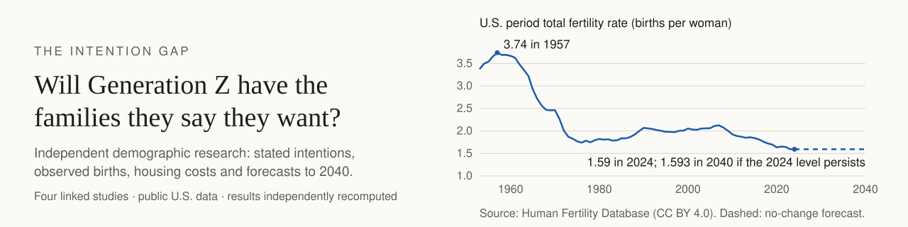
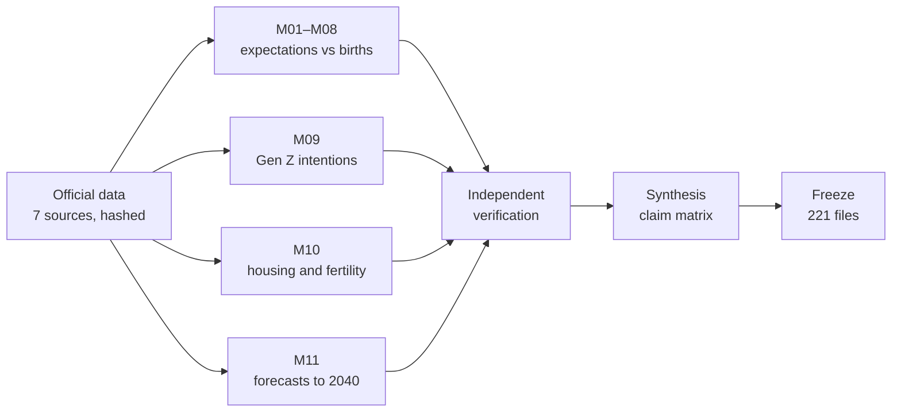
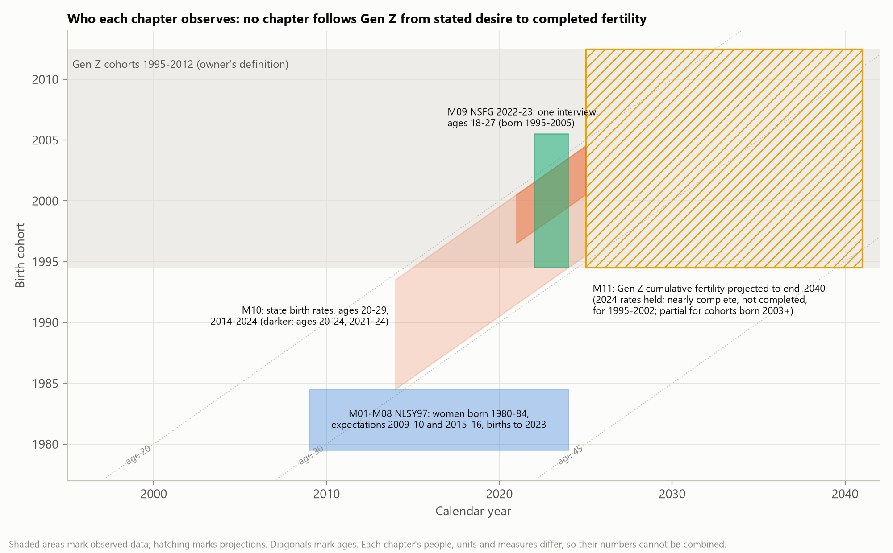
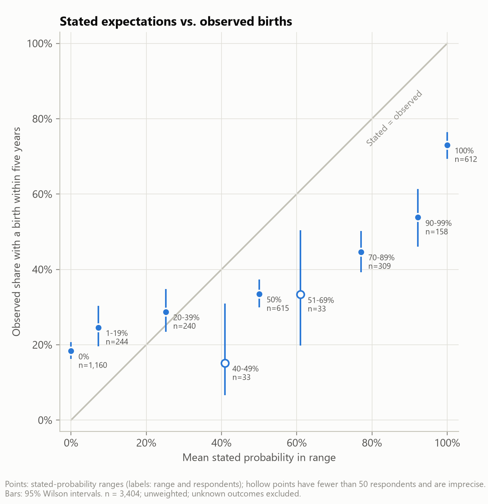
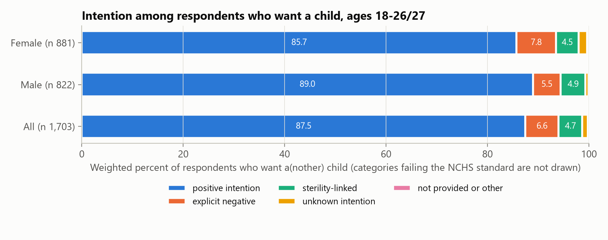
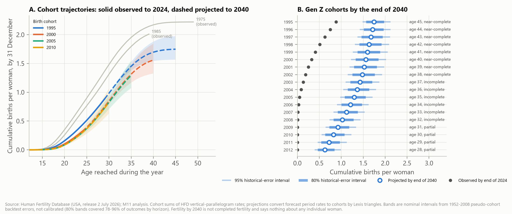

<picture>
  <source media="(prefers-color-scheme: dark)" srcset="assets/readme/header-dark.svg">
  
</picture>

# The Intention Gap

**An independent research project testing whether the evidence can support a popular claim: that young Americans will fall short of the families they say they want.** Four studies, seven official data sources, one integrated answer, with every material claim traced to a frozen value and every chapter's headline results independently recomputed.

[Manuscript](docs/final_synthesis_manuscript.md) · [Visual atlas](docs/visual_atlas.md) · [How it was built](docs/engineering_decisions.md) · [Technical walkthrough](docs/technical_walkthrough.md) · [Reproduce](#reproducibility)

## Research at a glance

| Measure | Detail |
|---|---|
| **4 research chapters** | longitudinal survey · cross-sectional survey · state panel · cohort forecast |
| **7 official data sources** | National Longitudinal Survey of Youth 1997 (NLSY97) · National Survey of Family Growth (NSFG) · American Community Survey (ACS) · CDC WONDER natality · National Center for Health Statistics (NCHS) · Census population estimates · Human Fertility Database (HFD) |
| **50 claims, 155 checks** | every material claim in the manuscript traced to a frozen value |
| **392 automated tests** | plus independent verifiers that recompute results with separate code |
| **221 frozen files** | five SHA-256 manifests, so results cannot change silently |
| **Status** | research complete and frozen (November 2026); not peer-reviewed |

## Why this project exists

U.S. fertility has fallen to about 1.6 births per woman, while surveys show that most young adults want children. That combination invites a confident story: Generation Z wants families it will not have. This project started from that question, defining Generation Z as the cohorts born 1995–2012, and asked what the evidence can actually establish. It went step by step:
- how good are people's stated fertility expectations;
- what the oldest members of Generation Z say they want and intend;
- whether housing costs track birth rates;
- where fertility is heading.

## The answer, and what supports it

**Whether Generation Z will have the families it wants cannot be established from existing data.**
- A population-average comparison would need a numeric desired family size and completed cohort fertility; neither exists yet.
- An answer about individuals would also need the same people followed over time.

No "gap" is calculated, because none of the sources measures one.

| Finding | Population | What kind of evidence |
|---|---|---|
| **69.9%** wanted a child (or another child) and **62.8%** intended one | U.S. adults aged about 18–27, 2022–23 (NSFG, weighted) | Stated answers at one interview |
| Of those who wanted a child, **11.2%** did not intend one. About 42% of that was the survey's sterility classification, not a stated "no" | Same | Stated answers |
| Demographic models **failed to show** meaningful out-of-sample improvement in predicting that "no" (area under the ROC curve, AUC, 0.51 against 0.50 for a no-information baseline) | Same | Negative machine-learning result |
| Stated chances of a birth ranked outcomes but were **far too extreme**: of women who said 0%, 18.4% had a birth; of those who said 100%, 73.0% | Women born 1980–84 (NLSY97, unweighted sample) | Expectations against observed births |
| Rent burden was **not robustly** associated with state birth rates (−2.77 births per 1,000 women aged 20–24 per 10-percentage-point higher burden; 95% confidence interval −5.81 to 0.26) | 51 states, 2014–24 | Ecological, not causal |
| **No alternative forecasting model** satisfied the locked model-selection criteria for replacing "no change". The 2040 total fertility rate (TFR) forecast is 1.593 births per woman, and its interval failed calibration | United States, HFD 1933–2024 | Model forecast |
| If 2024 rates persist, women born in 1995 reach about **1.75** births per woman by the end of 2040 (nearly complete), and those born in 2012 about **0.62** (partial) | Generation Z cohorts | Projection, not completed fertility |

The full argument, with limitations: [manuscript](docs/final_synthesis_manuscript.md) and [executive summary](docs/final_executive_summary.md).

## Research pipeline



Text version: seven hashed data sources feed four chapters. Each chapter is independently verified, the results are combined in a synthesis tied to a claim matrix, and 221 files are frozen.

Each chapter ran from protocol to baseline, model, out-of-sample evaluation, robustness and independent verification, and was closed before the next began. The header and tables round the 2040 forecast differently (1.59 and 1.593); the value is 1.593. The step-by-step pipeline and architecture are in [docs/research_pipeline.md](docs/research_pipeline.md).

## Visual highlights

<table>
<tr>
<td width="50%"><a href="docs/visual_atlas.md#who-each-chapter-observes"></a><br><b><a href="docs/visual_atlas.md#who-each-chapter-observes">Who each study observes</a>.</b> No source follows Generation Z from desire to completed fertility, which is why no gap is computed.</td>
<td width="50%"><a href="docs/visual_atlas.md#stated-chances-against-births-that-followed"></a><br><b><a href="docs/visual_atlas.md#stated-chances-against-births-that-followed">Expectations were informative but too extreme</a>.</b> NLSY97 women born 1980–84; unweighted sample.</td>
</tr>
<tr>
<td><a href="docs/visual_atlas.md#why-some-who-want-a-child-do-not-intend-one"></a><br><b><a href="docs/visual_atlas.md#why-some-who-want-a-child-do-not-intend-one">Wanting is not intending</a>.</b> NSFG 2022–23, ages about 18–27; weighted. Data Source: National Center for Health Statistics, National Survey of Family Growth, 2022-2023.</td>
<td><a href="docs/visual_atlas.md#generation-z-cohort-fertility-by-the-end-of-2040"></a><br><b><a href="docs/visual_atlas.md#generation-z-cohort-fertility-by-the-end-of-2040">Generation Z cohorts by 2040</a></b>, if 2024 rates persist. A projection, not completed fertility. HFD data, CC BY 4.0.</td>
</tr>
</table>

All 21 figures, with populations, units, uncertainty and limitations: **[visual atlas](docs/visual_atlas.md)**.

## Technical implementation

- **Survey statistics.** Design-based estimation with weights, strata and clusters, Korn–Graubard intervals and NCHS reliability suppression for the NSFG; a JKn jackknife and missing-outcome bounds for the NLSY97. The NSFG estimates are cross-checked against a separate survey library.
- **Machine learning with guardrails.** Leakage-audited features, household- and cluster-grouped splits, a dummy baseline, and calibration checks with scikit-learn. The negative result is reported as such.
- **Causal-inference hygiene without causal claims.** Two-way fixed effects, cluster-robust and wild-bootstrap inference, and a protocol hashed and locked before fitting.
- **Forecasting.** ARIMA, exponential smoothing and benchmark methods written directly in NumPy/SciPy; 72 pseudo-real-time backtest origins; cohort projection on Lexis triangles; interval calibration tested, and failing.
- **Verification engineering.** Independent recomputation for each chapter, a 155-check claim-to-evidence matrix, SHA-256 freeze manifests, Git rules that keep frozen bytes identical, hash-locked dependencies, and a release scanner for credentials and disclosure risks.

What each tool is used for: [technical walkthrough](docs/technical_walkthrough.md#technology-actually-used).

## Explore the project

| Start here | Go deeper |
|---|---|
| [Executive summary](docs/final_executive_summary.md) | [Integrated manuscript](docs/final_synthesis_manuscript.md) · [claim-to-evidence matrix](docs/final_claim_evidence_matrix.csv) · [limitations register](docs/final_limitations_register.md) |
| [Visual atlas](docs/visual_atlas.md) | Chapters: [NLSY97 expectations](docs/methodology.md) · [NSFG intentions](docs/nsfg_m09.md) · [housing](docs/m10_housing_fertility.md) · [forecasts](docs/m11_fertility_forecasts.md) |
| [How it was built](docs/engineering_decisions.md) | [Research pipeline and architecture](docs/research_pipeline.md) · [scientific audit log](audit/scientific-audit.md) |
| [Technical walkthrough](docs/technical_walkthrough.md) | [Environment and code quality](docs/environment_and_code_quality.md) · [security and disclosure](docs/security_and_disclosure_audit.md) · [contributing](CONTRIBUTING.md) |
| [Data sources and licences](docs/licensing_and_attribution.md) | [Bibliography](docs/bibliography.md) · [reproducibility guide](docs/final_reproducibility_guide.md) · [errata](docs/publication_errata.md) · [release readiness](docs/release_readiness.md) |

## Reproducibility

**Source-only checks** need no restricted data. They use Python 3.15.2 (`.python-version`):

```
python -m venv .venv
.venv/Scripts/activate                      # macOS/Linux: source .venv/bin/activate
python -m pip install --only-binary=:all: --require-hashes -r requirements-lock.txt
python audit/verify_freeze.py               # five manifests, 221 frozen files
python -m tools.release restore-run-record  # once per fresh clone
python -m unittest                          # tests that need restricted data report "skipped"
python audit/verify_final_synthesis.py      # claim matrix; raw-data checks report SKIP
```

**Full reproduction** reruns every chapter from the source data. Readers download the data themselves: the NLSY97 extracts from NLS Investigator, the NSFG and natality files from CDC, ACS through the Census API, and the HFD archive with a free account. Steps and expected outputs: [reproducibility guide](docs/final_reproducibility_guide.md). Raw and respondent-level data are never committed.

## Author contribution and status

The author posed the question, defined its scope, chose the data, made the governing methodological decisions, and reviewed and approved every stage. Implementation (code, tests, verifiers and documentation) was carried out with an AI coding assistant under the author's direction; [the walkthrough](docs/technical_walkthrough.md#author-contribution-and-ai-assistance) details the division of work. This is an independent portfolio research project: **not peer-reviewed**, and not affiliated with or endorsed by any data provider. A Streamlit dashboard prototype for the first chapter exists locally but is **not part of this repository**; it will be added only if a dashboard phase is authorized.

## Data, licensing and attribution

- **HFD.** Tables in `data/public/m11/`, the M11 figures and the header above contain extracts of estimates from the [Human Fertility Database](https://www.humanfertility.org) (Max Planck Institute for Demographic Research and Vienna Institute of Demography; USA release 2 July 2026, downloaded 20 November 2026). They are licensed [CC BY 4.0](https://creativecommons.org/licenses/by/4.0/) and were changed by this project.
- **NLSY97.** Bureau of Labor Statistics public-use data.
- **CDC/NCHS.** NSFG and natality data. The analyses and conclusions are the author's; NCHS is responsible only for the initial data release.
- **Census.** This product uses the Census Bureau Data API but is not endorsed or certified by the Census Bureau.

No provider endorses this project. A licence for the project's own code and text has been proposed (MIT for code, CC BY 4.0 for documentation) but is **not yet granted**. See [licensing and attribution](docs/licensing_and_attribution.md).
