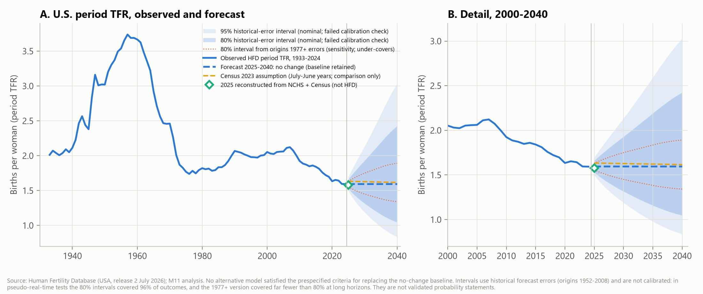
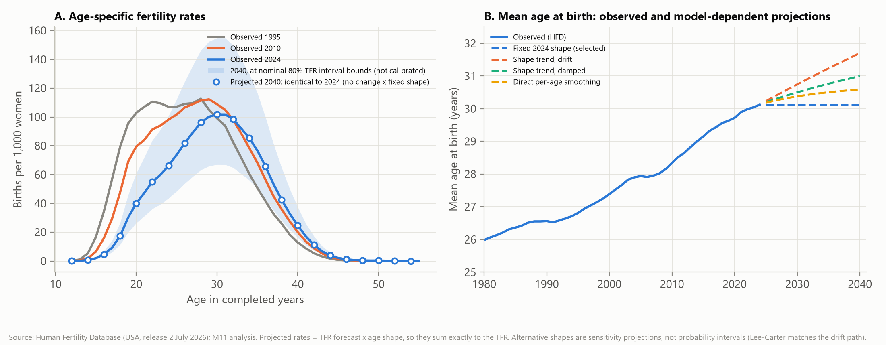
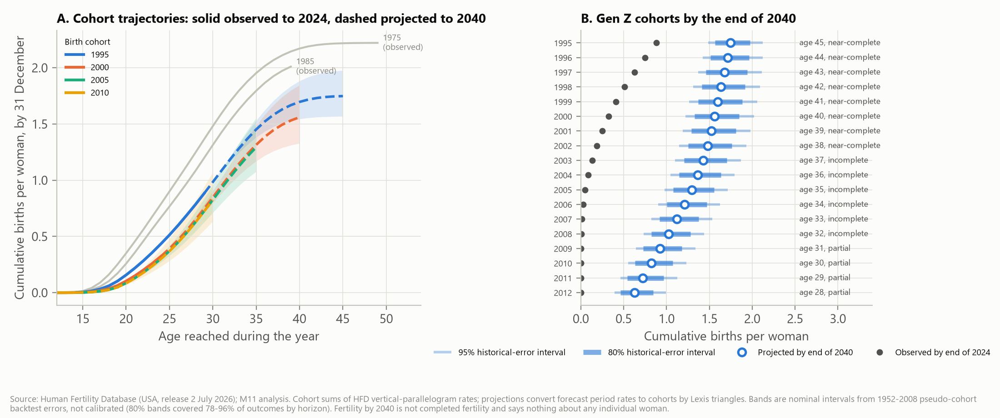
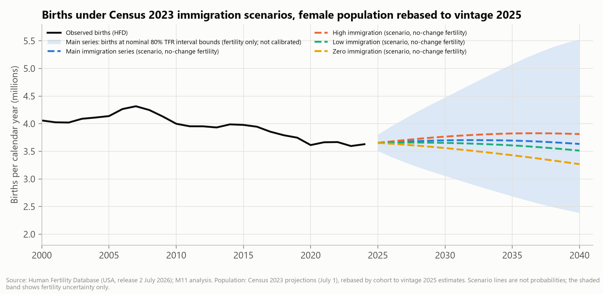

# M11: U.S. fertility to 2040 and Gen Z cohort fertility

**Status:** FROZEN, final scientific approval, 2026-11-20. The frozen files are listed in `docs/m11_freeze.sha256` and checked by `python audit/verify_freeze.py`. Editing any of them needs a recorded decision and a new manifest. The freeze record is in section 17.

**Protocol:** `docs/m11_forecast_protocol.md`, locked 2026-11-20 11:40:30 UTC (SHA-256 `b99eb898…7672`, no amendments). The lock is internal, not an external preregistration.

**Data:**
- HFD USA, release of 2 July 2026, 1933–2024.
- NCHS final 2025 births.
- Census vintage 2025 population estimates.
- Census 2023 National Population Projections.

**Run:** the frozen run (start time, code hashes, versions) is recorded in `docs/m11_frozen_run_record.json`. The live copy, `data/public/m11/forecast/m11_run_record.json`, is rewritten by every run and is not frozen. The first backtest run (11:49:19 UTC) and every decision are in `docs/m11_decision_log.md`.

## Summary

**A. National period fertility to 2040.**
- No alternative model satisfied the prespecified criteria for replacing the no-change baseline.
- Nine methods were backtested at 72 forecast origins (1952–2023). None met the locked selection rule.
- The closest were:
  - an autoregressive model on yearly changes (ARIMA(p,1,0)), whose mean absolute error over 5, 10 and 15 years was 0.942 times that of no change. That is a 5.8% average reduction, but it missed the required 10% improvement. It passed the rule's era and bootstrap conditions, but its advantage was not robust in sensitivity analyses (section 4);
  - convergence to the 30-year mean, at 0.991.
- Both are inside the uncertainty from only four independent 15-year windows.
- The point forecast is therefore the 2024 HFD TFR, **1.593**, held to 2040.
- The 2040 historical-error intervals are wide: **1.05–2.42** (nominal 80%) and **0.84–3.03** (nominal 95%).
- These intervals are **not historically calibrated**. They failed the prespecified calibration criterion and are not validated probability intervals.
  - Built in pseudo-real time from all earlier forecast errors, the 80% intervals contained the outcome **0.96** of the time at 5–15 years. They over-covered, because they carry baby-boom-era errors.
  - Built only from errors since 1977, they covered far less than nominal at long horizons (0.11 at 15 years).
- Neither version is a reliable probability statement about 2040. The point forecast carries no directional signal: no method projecting a rise or a fall met the criteria. The record cannot rule out large moves either way.

**B. Gen Z (born 1995–2012) cumulative fertility by the end of 2040.**
- Cohort fertility accumulated by the end of 2024 runs from 0.88 children per woman (born 1995, age 29) to almost zero (born 2010–2012).
- Projected to the end of 2040, it runs from **1.75** (born 1995, age 45; nominal 80% historical-error interval 1.57–1.98) to **0.62** (born 2012, age 28; 0.46–0.85).
- By historical standards:
  - the 1995–2002 cohorts will be nearly complete by 2040;
  - the 2003–2008 cohorts will be substantially but not fully complete;
  - the 2009–2012 cohorts will have had only part of their childbearing.
- These are aggregate projections that assume 2024 period rates continue. Assuming further postponement changes the endpoints by about ±0.1.
- The cohort intervals come from historical errors and are not calibrated. A post-review test that chose the strategy using only information available at each origin gave 7–17% larger average backtest errors than the fixed strategy. That difference is concentrated in six early origins (1976–1981), where sparse historical errors and unstable bootstrap selection limit generalization, so it does not show that the fixed-strategy backtest is generally optimistic (section 13).

**C. Whether Gen Z will achieve its desired family size.**
- Not establishable from these data.
- M09 (NSFG 2022–2023) has no numeric desired family size.
- M11 forecasts aggregate fertility, partly before childbearing is complete, and observes no individual's intentions.
- Section 12 explains why the M09 and M11 numbers cannot be differenced to measure fulfilment.

## 1. Scope and definitions

| Quantity | Definition | Source |
|---|---|---|
| Period TFR | Sum over ages 12–55 of HFD single-year ASFR (Lexis squares, age in completed years; `12-` and `55+` open). Equals the HFD TFR within print precision | `USAasfrRR.txt` |
| Age-specific fertility rate (ASFR) | Births per woman-year of exposure at each completed age 12–55. Forecasts are TFR × age shape, so they sum exactly to the TFR | HFD RR |
| Cohort cumulative fertility by 31 December of year Y | Running sum of HFD vertical-parallelogram rates (VV: year × age reached during the year), which belong to one cohort each. At the end of Y a woman born in c is aged between Y − c and Y − c + 1 | `USAasfrVV.txt` |
| HFD CCFR | Cumulative cohort fertility *before* exact age x (Lexis horizontal parallelograms), shown alongside for fully observed ages | `USAccfrVH.txt` |
| Gen Z | Birth cohorts 1995–2012 (owner's definition) | — |

**Stage 1 correction.** The feasibility audit reported HFD cohort-summary warnings (CCFR, CCF and CCF40 differences up to 0.0008). The cause was an error in my code, not in HFD.
- HFD exposure files print the open ages as `12` and `55`, while birth and rate files print `12-` and `55+`.
- The validation joined on that label, so 182 open-age cohort cells were dropped.
- With the join corrected, all 3,133 CCFR cells and 124 CCF/CCF40 values agree with sums of exact rates within half a print unit (0.0005). The checks now pass.
- Two vertical-parallelogram checks were added: VV rates = births ÷ exposure, and each VV cell = the upper triangle of age a − 1 plus the lower triangle of age a, of one cohort.
- No HFD observation was changed. The HFD source is now 16 PASS. Its two remaining warnings are coverage notes: data end in 2024, and the HFD input files need a login.

## 2. Protocol, timeline and what was seen

| UTC, 2026-11-20 | Event |
|---|---|
| ~11:15–11:35 | Stage 1 correction (no model fitted) |
| 11:38 | Protocol drafted |
| 11:40:30 | Protocol locked (`docs/m11_protocol_lock.json`) |
| 11:41–11:48 | Code written and tested on synthetic data only |
| 11:49:19 | First backtest run |
| 12:02 | Rerun after an output-precision change; 43 of 45 tables byte-identical, no result changed |

**Before locking:**
- The HFD series had been inspected descriptively in the feasibility stage, so the protocol is blind to forecast performance, not to the data.
- Seen: turning points 1957, 1976, 2007 and 2024, and the 2025 derived TFR.

**After the first run:**
- No method, setting or selection rule changed.
- The later entries in the decision log are: one interpretation for a robustness analysis (R3, condition 2 split at 2000), a raise in output precision, and verifier tolerances matched to the stored precision.
- No exploratory analysis was added after results were known.

## 3. Backtest design

- **Origins and training:** at each origin T = 1952…2023, every method is re-estimated on HFD years 1933…T only, and forecasts horizons 1–16 up to 2024. That gives 72 origins and 1,032 records per method.
- **Evaluation:** primary horizons are 5, 10 and 15 years. All horizons feed interval calibration; horizon 16 corresponds to 2040.
- **Overlap:** neighbouring origins share most of their target years. There are 68, 63 and 58 origins at 5, 10 and 15 years, but only 14, 7 and 4 non-overlapping windows.
- **Accounting for dependence:**
  - accuracy comparisons use a circular block bootstrap with block length h;
  - Diebold–Mariano tests use a HAC variance with lag h − 1 and the small-sample correction, and are reported as descriptive only.
- **Methods**, all on log TFR so forecasts stay positive:
  - no change (`naive`);
  - 10-year mean;
  - 10-year drift, plain and damped;
  - linear convergence to the 30-year mean;
  - simple exponential smoothing (SES);
  - damped-trend exponential smoothing;
  - AR(p) with mean;
  - ARIMA(p,1,0) (`ari`).

  Orders and smoothing weights are chosen at each origin from training data alone. No machine learning or flexible model was fitted: four independent long windows cannot support it, and no method showed a structured failure that one could address.
- **Leakage checks:**
  - every record stores its training span;
  - a "poisoned future" test overwrites all later years with 9.9 and leaves every forecast unchanged.

## 4. Backtest results and model selection (question A)

**Accuracy by method.** Mean absolute error of TFR forecasts (children per woman) relative to no change. Below 1 is better.

| Method | h = 5 | h = 10 | h = 15 | R (mean) | Bootstrap 90th pct of R | Passes rule? |
|---|---:|---:|---:|---:|---:|---|
| no change (`naive`) | 1.000 | 1.000 | 1.000 | 1.000 | — | baseline |
| SES | 1.000 | 1.000 | 1.000 | 1.000 | 1.000 | no (equals no change: smoothing weight at its bound, 0.9999, at every origin) |
| `ari` | 0.911 | 0.946 | 0.968 | **0.942** | 0.997 | no: R > 0.90 (passed the era and bootstrap conditions) |
| converge30 | 1.118 | 0.976 | 0.879 | **0.991** | 1.213 | no |
| 10-year mean | 1.686 | 1.277 | 1.082 | 1.348 | 1.536 | no |
| 10-year drift | 1.140 | 1.500 | 1.795 | 1.478 | 1.820 | no |
| damped drift | 1.044 | 1.222 | 1.277 | 1.181 | 1.381 | no |
| damped-trend ETS | 1.045 | 1.259 | 1.343 | 1.216 | 1.348 | no |
| AR(p) with mean | 1.455 | 1.709 | 1.857 | 1.673 | 1.824 | no |

No change itself had a mean absolute error of 0.222, 0.393 and 0.552 at 5, 10 and 15 years, with mean errors of −0.136, −0.299 and −0.433. Forecasts were too high on average, because most origins precede declines.

**Errors depend heavily on the era.**

| Origin era | No-change MAE h = 5 / 10 / 15 | `ari` relative MAE h = 5 / 10 / 15 |
|---|---|---|
| 1952–1976 (boom and bust) | 0.432 / 0.738 / 1.009 | 0.882 / 0.929 / 0.960 |
| 1977–1999 | 0.077 / 0.117 / 0.138 | 1.200 / 1.071 / 0.953 |
| 2000–2023 | 0.126 / 0.243 / 0.364 | 0.831 / 0.939 / 1.032 |

**Selection.**
- The locked rule requires mean relative MAE ≤ 0.90, a gain at every primary horizon in both origin groups (before and from 1977), and a bootstrap upper bound below 1.
- No alternative model satisfied the prespecified criteria for replacing the no-change baseline. **No change is retained.**
- ARIMA(p,1,0) reduced average error by 5.8% (R = 0.942). It passed the era condition and, narrowly, the bootstrap condition (0.997 < 1), but missed the required improvement (R ≤ 0.90).
- Its gain was not robust: it was worse than no change at 5 and 10 years for origins 1977–1999 (1.20 and 1.07). Within origins from 1977 its R was 0.991, with a bootstrap bound of 1.07.
- Diebold–Mariano p-values for `ari` against no change are 0.30 (h = 5) and 0.53 (h = 15).
- A pseudo-real-time version of the selection rule, using only errors known at each origin, chose no change at 66 origins and converge30 at 6. Its errors were 1.02–1.06 times those of no change, so adaptive selection did not help.

**Error growth.** No-change RMSE rises from 0.080 at 1 year to 0.821 at 16 years, roughly ∝ h^0.84. That is faster than independent annual errors (h^0.5) would give: long-horizon errors are dominated by persistent regime shifts.

## 5. National TFR forecast, 2025–2040



| Year | Forecast | 80% historical-error interval (primary) | 95% historical-error interval (primary) | 80%, errors from 1977+ origins | 80%, empirical quantiles | 80%, model-based range |
|---|---:|---|---|---|---|---|
| 2025 | 1.593 | 1.53–1.66 | 1.50–1.70 | 1.56–1.63 | 1.53–1.63 | 1.51–1.68 |
| 2030 | 1.593 | 1.32–1.93 | 1.19–2.13 | 1.45–1.75 | 1.18–1.70 | 1.41–1.81 |
| 2035 | 1.593 | 1.16–2.19 | 0.98–2.59 | 1.38–1.84 | 1.05–1.76 | 1.35–1.89 |
| 2040 | **1.593** | **1.05–2.42** | **0.84–3.03** | 1.34–1.89 | 0.83–1.80 | 1.30–1.95 |

**Primary intervals** (protocol 8.1). These are historical-error intervals at nominal levels, not validated probability intervals:
- log-normal around the forecast;
- the spread at each horizon is the root-mean-square of the no-change log errors at that horizon over all backtest origins (57 errors for 2040).

**Calibration** (pseudo-real time; each interval uses only errors observable at its origin, at least 10):

| Interval | 80% coverage, h = 5/10/15 (90% bootstrap range) | 95% coverage | Pattern |
|---|---|---|---|
| Primary: errors from all earlier origins | **0.96** (0.91–1.00) | 1.00 | Over-covers: 100% beyond 9 years |
| Errors from origins 1977+ only | 0.72 / 0.42 / 0.11 at h = 5 / 10 / 15 | 0.86 / 0.68 / 0.44 | Under-covers badly at long horizons |
| Model-based random walk | 0.70 (0.57–0.84) | 0.83 | Under-covers; 0.61 at 16 years |

- The pre-specified flag applies: the primary 80% coverage lies outside 65–95%, so every output labels these intervals "not historically calibrated".
- The two empirical versions fail in opposite directions. That is the structural-break problem: the error distribution is not stable across U.S. fertility regimes.
- The primary interval over-covered historically and keeps the possibility of a boom-sized shift. The 1977+ version would have been badly overconfident during the post-2007 decline. No version is a validated probability interval.

**Interval types used in M11** (`m11_fc_data_dictionary.csv`):

| Type | Where | Probability interpretation |
|---|---|---|
| Historical-error interval (nominal level) | TFR primary and sensitivity intervals; cohort intervals; ASFR and births at TFR bounds | Built from past forecast errors to target a nominal level. Coverage was tested and failed or varied by era, so it is not a validated probability |
| Empirically calibrated prediction interval | None | No M11 interval met a calibration criterion |
| Model-dependent uncertainty range | Model-based intervals; alternative methods, windows and age shapes | Depends on model assumptions; historically under-covered |
| Scenario range | Census immigration scenarios | None |
| Descriptive band | 2025 reconstruction, E2 ± 2 × RMSE | None |

**Model dependence**, not probability intervals (figure: `m11_fc_sensitivity.png`):
- 2040 forecasts of the nine methods range from 1.24 (10-year drift) to 1.83 (convergence to the 30-year mean).
- The training window (from 1933, from 1977 or rolling 30 years) changes only the AR model materially: 1.31–1.70.
- The no-change forecast is very sensitive to its jump-off year: 1.84 from 2015, 1.70 from 2019, 1.59 from 2024.

## 6. 2025: external check and secondary forecast

| Quantity | 2025 TFR |
|---|---:|
| Primary forecast, HFD ≤ 2024 | 1.593 (80% 1.53–1.66) |
| Reconstructed, HFD-compatible (E2: vintage 2025 population × HFD/Census exposure ratio of 2024) | **1.577** (descriptive band E2 ± 2 × RMSE of four backtest errors: 1.573–1.582; not a confidence or prediction interval) |
| Reconstructed, raw vintage 2025 July 1 population (E1) | 1.575 |
| Reconstructed, mean ratio 2021–2024 (E3) | 1.574 |
| NCHS-derived (5 × rounded 5-year rates, vintage 2025; not an official TFR) | 1.576 |

**The reconstruction.**
- Births: NCHS final 2025 resident births by single age (3,612,012, equal to the official total). The 50–54 group is split over HFD ages 50–55+.
- Backtest: for 2021–2024, the method reproduced the HFD TFR within −0.0045 to +0.0038 (RMSE 0.0023 with vintage 2025).

**Plausibility.**
- Every 2025 estimate lies inside the primary nominal 80% interval.
- 2025 continued the decline: the one-year error of no change is about −0.016, within the range of past one-year errors (RMSE 0.080).

**Secondary 2025-informed forecast** (`m11_fc_tfr_forecast_secondary_2025.csv`):
- Appending the reconstructed 1.577 and holding it gives 1.577 to 2040.
- It is labelled secondary because it contains a non-HFD value, and it does not replace the primary forecast.

## 7. Age-specific fertility (secondary 1)

**Methods compared.** Five age-profile methods, backtested at the same origins:

| Method | Type | Shape L1 relative to fixed shape, h = 5 / 10 / 15 | R | Before 1977, h = 15 | From 1977, h = 15 |
|---|---|---|---:|---:|---:|
| `S0_fixed` (2024 shape) | profile | 1 / 1 / 1 | 1.000 | — | — |
| `S1_shape_drift` (compositional Lee–Carter, drift) | profile | 0.881 / 0.915 / 0.958 | 0.918 | 1.155 | 0.865 |
| `S2_shape_damped` | profile | 0.969 / 1.044 / 1.068 | 1.027 | 1.073 | 1.065 |
| `S3_direct_ets` (damped trend per age) | direct | 0.802 / 0.883 / 0.996 | 0.894 | 1.443 | 0.785 |
| `S4_lee_carter` (log rates) | direct | 0.893 / 0.928 / 0.973 | 0.931 | 1.147 | 0.891 |

**Selection.**
- No method passed the locked rule, so the **fixed 2024 shape is retained**.
- Direct per-age smoothing came closest (R = 0.894, bootstrap bound 0.986), but it was much worse than the fixed shape before 1977.
- The finding is regime-dependent. Since 1977, when the age at birth rose steadily, every trend method beat the fixed shape at 5 years, by 5–34%. The protocol requires gains in both eras, and none achieved that.

**Published schedule.**
- ASFR(t, x) = 1.593 × 2024 shape. This equals the 2024 HFD schedule in every year to 2040, and the rates sum exactly to the TFR (max gap 2 × 10⁻¹⁶).
- All rates are non-negative.
- Diagnostics:
  - maximum curvature of log rates over ages 15–45 is 0.27 against an observed maximum of 0.29 (1995–2024);
  - no jump at the jump-off: shape change 1.3 × 10⁻⁵, from flooring zero rates at 5 × 10⁻⁶.

**Direct methods are incoherent with the TFR, and reconciliation helps.**

| Method, h = 15 | Implied-TFR MAE | ASFR MAE unreconciled (per 1,000) | ASFR MAE reconciled to the TFR forecast |
|---|---:|---:|---:|
| `S3_direct_ets` | 0.739 | 18.8 | 15.0 |
| `S4_lee_carter` | 1.125 | 26.6 | 15.1 |

The TFR implied by the direct methods is less accurate than no change (MAE 0.552). Scaling them to the selected TFR cut their age-specific errors by 20–43%.

**Mean age at birth in 2040** (model-dependent, figure `m11_fc_age_profiles.png`):

| Shape method | 2040 |
|---|---:|
| fixed (selected) | 30.1 |
| damped trend | 31.0 |
| direct smoothing | 30.6 |
| drift and Lee–Carter | 31.7 |



## 8. Gen Z cohort fertility (secondary 2, question B)

**Period-to-cohort transformation.**
- A forecast Lexis square holds two cohorts, so period forecasts are converted to vertical parallelograms of one cohort each:
  - T1: the average of the two adjacent squares;
  - T2: T1 × the observed VV/T1 ratio of the last 5 years.
- In-sample over 1938–2024, 16-year cohort increments for women aged 12–29 were reproduced with mean absolute error 0.0017 (T1) and **0.0010 (T2, used)**, against the 0.01 acceptance limit.
- Choosing T1 instead changes the 2040 endpoints by ≤ 0.002.

**Pseudo-cohort backtests.**
- For each origin 1952–2008, the pipeline projected cohorts aged 12–29 up to 16 years ahead. Every model was refitted with data up to the origin, but the strategy (no change × fixed shape × T2) was chosen in hindsight from the full evaluation. Section 13 tests a strategy chosen only from information available at each origin.
- Errors at 16 years:

| Age at origin | Origins | MAE | Mean error | Mean observed increment |
|---|---:|---:|---:|---:|
| 12–17 | 57 | 0.259 | −0.227 | 1.56 |
| 18–23 | 57 | 0.214 | −0.088 | 1.68 |
| 24–29 | 57 | 0.143 | −0.025 | 1.01 |

- Past projections were too high on average, mostly in the post-boom decline.
- Cohort intervals are log-normal on the projected increment. Their spread comes from these errors at the same age at origin (±1 year) and horizon.
- In pseudo-real time, 80% intervals covered 0.78, 0.83, 0.94 and 0.96 (0.9648) of outcomes at 5, 10, 15 and 16 years: near nominal at 5–10 years, above nominal at 15–16.
- When spreads come only from post-1976 errors, coverage falls to 0.59–0.76 (section 13).
- These are historical-error intervals, not validated probability intervals. Coverage pools overlapping cohorts and origins, so it is approximate.



**Gen Z endpoints** (children per woman):

| Cohort | By end-2024 (age) | HFD CCFR at exact age | By end-2040 (age) | 80% historical-error interval | 95% historical-error interval | Historical completion share at that age | Label |
|---|---|---:|---|---|---|---|---|
| 1995 | 0.88 (29) | 0.833 (29) | **1.75** (45) | 1.57–1.98 | 1.49–2.12 | 0.998–0.999 | nearly complete |
| 1996 | 0.75 (28) | 0.703 (28) | 1.71 (44) | 1.51–1.96 | 1.42–2.12 | 0.997–0.998 | nearly complete |
| 1997 | 0.63 (27) | 0.583 (27) | 1.67 (43) | 1.46–1.94 | 1.37–2.11 | 0.995–0.996 | nearly complete |
| 1998 | 0.51 (26) | 0.471 (26) | 1.64 (42) | 1.41–1.92 | 1.31–2.09 | 0.991–0.992 | nearly complete |
| 1999 | 0.41 (25) | 0.372 (25) | 1.60 (41) | 1.37–1.88 | 1.26–2.06 | 0.986–0.987 | nearly complete |
| 2000 | 0.32 (24) | 0.289 (24) | 1.56 (40) | 1.33–1.85 | 1.22–2.02 | 0.978–0.980 | nearly complete |
| 2001 | 0.25 (23) | 0.221 (23) | 1.52 (39) | 1.29–1.81 | 1.19–1.98 | 0.966–0.969 | nearly complete |
| 2002 | 0.19 (22) | 0.162 (22) | 1.48 (38) | 1.25–1.76 | 1.15–1.93 | 0.951–0.954 | nearly complete |
| 2003 | 0.13 (21) | 0.110 (21) | 1.43 (37) | 1.20–1.70 | 1.10–1.87 | 0.932–0.936 | substantial, incomplete |
| 2004 | 0.09 (20) | 0.067 (20) | 1.37 (36) | 1.15–1.63 | 1.05–1.79 | 0.908–0.914 | substantial, incomplete |
| 2005 | 0.05 (19) | 0.035 (19) | 1.29 (35) | 1.08–1.55 | 0.98–1.71 | 0.879–0.887 | substantial, incomplete |
| 2006 | 0.03 (18) | 0.017 (18) | 1.21 (34) | 1.00–1.47 | 0.91–1.62 | 0.844–0.856 | substantial, incomplete |
| 2007 | 0.01 (17) | 0.008 (17) | 1.12 (33) | 0.92–1.38 | 0.82–1.53 | 0.805–0.821 | substantial, incomplete |
| 2008 | 0.01 (16) | 0.003 (16) | 1.03 (32) | 0.83–1.28 | 0.74–1.44 | 0.762–0.781 | substantial, incomplete |
| 2009 | 0.00 (15) | 0.001 (15) | 0.93 (31) | 0.73–1.18 | 0.64–1.34 | 0.716–0.738 | partial |
| 2010 | 0.00 (14) | 0.000 (14) | 0.82 (30) | 0.63–1.07 | 0.55–1.23 | 0.667–0.691 | partial |
| 2011 | 0.00 (13) | 0.000 (13) | 0.72 (29) | 0.54–0.97 | 0.46–1.13 | 0.615–0.642 | partial |
| 2012 | 0.00 (12) | — (no complete cell) | **0.62** (28) | 0.46–0.85 | 0.39–0.99 | 0.562–0.589 | partial |

**How to read this table.**
- **Two measures of observed fertility.** "By end-2024" sums VV rates to 31 December 2024. The HFD CCFR counts fertility before an exact age, so it is lower by about the 2024 lower Lexis triangle.
- **Completion shares.** These are the shares of completed fertility that the 1965–1974 cohorts had reached by the same age.
- **Shares are upper bounds.** Because births now come later, the true completeness of Gen Z by 2040 is probably lower than these shares suggest.
- **What "nearly complete" means.** For the 1995–2002 cohorts, fertility by 2040 is a good approximation to completed fertility if historical age patterns hold. For later cohorts it is not.
- **No completed fertility.** No cohort's completed fertility is forecast here.

**Sensitivity to the age-profile assumption (R9).** Continued postponement (shape drift or Lee–Carter) raises the 2040 endpoint for the oldest cohorts and lowers it for the youngest. They have more years at the older ages that would gain, and fewer at the younger ages that would lose. For example:

| Cohort | Fixed shape | Drift | Damped |
|---|---:|---:|---:|
| 1995 | 1.75 | 1.83 | 1.80 |
| 2012 | 0.62 | 0.51 | 0.56 |

All of these lie inside the 80% intervals.

## 9. Census scenarios and births (secondary 3)

**Gates (protocol section 11).**
1. **Exposure alignment.** HFD ASFR × vintage 2025 female population reproduced HFD births within −0.18% to +0.18% for 2021–2024 (tolerance 1%). Passed.
2. **Rebasing test.** NP2023 (base July 2022) was rebased to vintage 2025 at 2022 and used to predict vintage 2025 for 2023–2025 at ages 12–55.

   | Method | Mean absolute % error, 2023 / 2024 / 2025 |
   |---|---|
   | unrebased | 1.35 / 1.95 / 2.04 |
   | age ratio | 0.61 / 1.26 / 1.33 |
   | cohort ratio | **0.48 / 1.12 / 1.24** |

   The cohort-ratio method beat unrebased at every horizon, so it was applied at 2025. Unrebased NP2023 has 2.2% fewer women aged 15–49 in 2025 than vintage 2025.

**Births**, calendar years, no-change fertility × rebased July 1 female population:

| Scenario (immigration) | Women 15–49, 2040 | Births 2030 | Births 2040 |
|---|---:|---:|---:|
| Main series | 79.2 million | 3.70 million | **3.63 million** |
| High | 82.6 million | 3.77 million | 3.81 million |
| Low | 77.0 million | 3.65 million | 3.51 million |
| Zero | 72.3 million | 3.56 million | 3.27 million |

**Two kinds of uncertainty, kept separate.**
- **Fertility:** in the main series, births at the bounds of the nominal 80% TFR interval (not calibrated) are 2.39–5.53 million in 2040. This is the larger of the two.
- **Population:** the spread across immigration scenarios at fixed fertility is 3.27–3.81 million. These are scenarios, not probabilities.

The four scenarios coincide in 2025 because each is rebased to the same vintage 2025 estimate. Without rebasing, 2040 births in the main series would be 3.56 million.

**Comparison with Census.**
- Census births run July to June. Our two-calendar-year averages are 0.5–1.4% above the Census main series.
- Our births are 1.7–3.3% above in the low scenario, 4.0–7.6% above in the zero scenario and 1.0–1.2% below in the high scenario.
- The differences combine the rebasing with Census's slightly higher assumed TFR.
- The Census fertility assumption (1.633 in 2025 falling to 1.616 in 2040) lies inside our nominal 80% interval in every year. It was used only for comparison.



## 10. Robustness and structural breaks

| Id | Analysis | Result |
|---|---|---|
| R1 | Training from 1977 (origins 1996–2023) | Damped drift and 10-year drift beat no change at 5 years (0.73–0.74), but not at 15 years (1.15–1.32). No change has MAE 0.113 / 0.211 / 0.295 |
| R2 | Rolling 30-year windows | Same conclusion: no alternative model met the replacement criteria. AR(p) worsens (relative MAE 1.56–1.93); damped trend moves slightly (1.00–1.25) |
| R3 | Selection rule within origins 1977+ (era split at 2000) | No change still selected; best `ari`, R = 0.991 |
| R4 | 2040 TFR by method | 1.24–1.83 |
| R5 | Parameter stability | `ari` order 3 at 61 of 72 origins; AR(p) order 3 at 50; SES weight at its upper bound everywhere; damped-trend φ at its lower bound (0.80) at over a quarter of origins (median 0.82) |
| R6 | Jump-off year | 2040 no-change forecast from 1.84 (origin 2015) to 1.59 (2024) |
| R7 | Error growth | No-change RMSE ∝ h^0.84 |
| R8 | Pandemic: forecasts from 2019 | No change over-predicted 2023–2024 by about 0.10; damped drift was within 0.04 across 2020–2024. A trend method would have done better in this decline, but not across the full history |
| R9 | Age-profile assumption in cohort projections | Gen Z endpoints vary by about ±0.1 (section 8) |
| R10 | Cohort conventions | VV end-of-year and HFD exact-age CCFR differ by the 2024 lower triangle (0.03–0.05 for the oldest cohorts); T1 against T2 by ≤ 0.002 |
| R11 | 2025-informed secondary | 1.577 throughout, against 1.593 primary |
| R12 | Census vintage | Rebased against unrebased main-series births in 2040: 3.63 against 3.56 million |
| R13 | Intervals built from 1977+ errors | Strong under-coverage at long horizons (section 5) |

**Robust:**
- no alternative model met the criteria for replacing no change, and none improved on it consistently across regimes;
- long-horizon uncertainty is large;
- the 1995–2002 cohorts are close to completing their fertility by 2040, and the 2009–2012 cohorts are far from it;
- reconciling direct age models to a TFR forecast improves them;
- the Census fertility assumption is within the forecast uncertainty.

**Assumption-dependent:**
- the width of the TFR interval, which depends on which historical era is used;
- the age profile in 2040;
- Gen Z endpoints, about ±0.1;
- births, which depend on immigration scenario and rebasing.

## 11. Null, negative and unstable findings

- **No alternative model satisfied the prespecified criteria for replacing the no-change baseline.** ARIMA(p,1,0) reduced average error by 5.8% but missed the 10% threshold. Damped-trend ETS and AR were worse than no change on average. Simple exponential smoothing collapses to no change.
- **Mean reversion fails.** The AR model with a mean was the worst method (R = 1.673), because it pulls forecasts back to the 1933-onward mean.
- **No age-profile method improves on the fixed shape** across both eras, even though trend methods win after 1977.
- **Pseudo-real-time model selection is worse than always choosing no change** (1.02–1.06).
- **Neither interval calibration is stable.** Calibrating on full-history errors over-covers; calibrating on 1977+ errors under-covers. The 2040 interval cannot be called calibrated.
- **The post-review origin-local comparison does not generalize.** A strategy chosen only from information available at each origin had 7–17% larger average cohort errors, but the difference is concentrated in six early origins (1976–1981), where sparse historical errors and unstable bootstrap selection limit generalization (post-review, section 13).
- **Diebold–Mariano tests are inconclusive** for every method. With four independent 15-year windows, the backtest has little power.

## 12. Answers to the three questions

**A. What may happen to national period fertility by 2040?**
- The best-supported point forecast is no change from 2024: a TFR of 1.593.
- This is a statement that the record contains no reliable signal for direction, not a prediction of stability.
- The nominal 80% historical-error interval for 2040 (1.05–2.42) is wide. It over-covered historically and is not a validated probability interval. Narrower intervals based on the calmer post-1977 record would have been badly overconfident.
- The 2025 data (reconstructed 1.577) show the decline continued for one more year, within the forecast range.

**B. What may happen to cumulative fertility among the 1995–2012 cohorts by 2040?**
- If 2024 age-specific rates persist, the 1995 cohort reaches about 1.75 children per woman by the end of 2040 (age 45), and the 2012 cohort about 0.62 (age 28).
- Intervals widen for younger cohorts.
- Only the 1995–2002 cohorts will be nearly complete by historical standards. For the rest, fertility by 2040 is partial and must not be read as completed fertility.

**C. Can these results establish whether Gen Z will achieve its desired family size? No.**
- **No measure of desire.** M09's NSFG 2022–2023 has no numeric desired or ideal family size; wanting a child is a yes/no item.
- **M09's expected total is not a desire.** M09 reports intentions and *expected* births. The expected total of 1.61 for women aged 18–27 is an expectation stated in 2022–2023, not a desire.
- **Different populations.** M09 covers people born about 1995–2004 who were 18 or older at interview; M11 covers the 1995–2012 cohorts.
- **Aggregates, not individuals.** M11 projects population averages. It does not observe any individual's intentions or whether they were met.
- **Not yet complete.** For most Gen Z cohorts, fertility by 2040 is not completed fertility.
- **No valid difference.** Subtracting a projected cohort average from a stated expectation would not measure fulfilment. Even a match in averages would be consistent with many individuals over- and under-achieving.

## 13. Post-review corrections and robustness (not pre-specified)

These were added on 2026-11-20 after the independent review. The protocol is unchanged, with no amendment. The locked analyses, their selections and their numbers are unchanged. Every step is time-stamped in `docs/m11_decision_log.md`. This section is separate from the original locked analysis (sections 3–12).

### 13.1 Corrections

| Issue | Correction | Numbers changed? |
|---|---|---|
| Cohort intervals were described as "reasonably calibrated" | Audited, with no defect found: the interval spreads, bounds and pseudo-real-time coverage (including 0.9648 at 16 years) are recomputed independently. They are now described as historical-error intervals that are near nominal at 5–10 years, above nominal at 15–16 years, and dependent on the calibration era | No |
| TFR intervals were called "prediction intervals" and their type was named `empirical_calibrated` | Now called historical-error intervals (nominal level) that failed the calibration criterion. The type is renamed `historical_error`, every table carries an `interval_label`, and `m11_fc_data_dictionary.csv` gives the type of every interval-like column | No |
| The 2025 "E2 ± 2 RMSE" band was stored in `lower95`/`upper95` | Moved to `band_lower`/`band_upper` and labelled a descriptive band from four backtest errors, not a confidence or prediction interval | No |
| The figure said "no method beat it" | Replaced by "No alternative model satisfied the prespecified criteria for replacing the no-change baseline." Interval legends now name their type | No |
| ARIMA's result was summarised loosely | ARIMA reduced average error by 5.8% and missed only the ≤ 0.90 improvement condition. It passed the era condition and, narrowly, the bootstrap condition. Its gain was not robust in sensitivity analyses (section 4) | No |

### 13.2 Origin-local strategy selection for the cohort backtests

**Why.** The locked pseudo-cohort backtest (section 8) refits every model with data up to each origin. But it always applies the strategy chosen afterwards from the full 1952–2023 evaluation: no-change TFR × fixed shape × transformation T2. Its errors therefore describe that strategy, not a fully prospective procedure.

**Design** (`analysis/m11_origin_local.py`). At each origin T, every choice uses only information available at T:
- **TFR method and age shape:** the pseudo-real-time selection rule (protocol 8.4, conditions 1 and 3), applied to backtest errors whose target year is ≤ T, with at least 10 errors at each of 5, 10 and 15 years.
- **Transformation (T1 or T2):** the smaller error on 16-year validation windows ending by T, with at least 10 windows.
- **Interval spread:** this strategy's own errors with target ≤ T.

Each chosen forecast was already fitted with data ≤ T. It is evaluated against later observed cohort fertility and compared with the fixed strategy on the same origins.

**Eligibility.**
- Eligible origins: **1976–2008 (33)**.
- **1952–1975 (24) are excluded** and recorded in `m11_pr_origin_local_choices.csv`: fewer than 10 errors were available at 15 years, and before 1962 there were also too few transformation windows.
- Excluded origins are not filled with a default.

**Choices made.**

| Component | Choice |
|---|---|
| TFR | no change at 27 origins; converge30 at 6 (1976–1981, when it qualified on the errors then available). The 1981 choice is Monte Carlo-sensitive: across 10 bootstrap seeds the bound for converge30 straddles 1 (0.998–1.011; the locked seed gives 0.9982). With no change at 1981 instead, the all-ages error ratios below become 1.13, 1.15, 1.08 and 1.06 |
| Age shape | fixed at all 33 (no method qualified) |
| Transformation | T2 everywhere |

**Results** (`m11_pr_origin_local_cohort_comparison.csv`). Cohort mean absolute error of the origin-local strategy relative to the fixed strategy, same origins:

| Age at origin | h = 5 | h = 10 | h = 15 | h = 16 |
|---|---:|---:|---:|---:|
| 12–17 | 1.20 | 1.41 | 1.55 | 1.51 |
| 18–23 | 1.33 | 1.33 | 0.93 | 0.89 |
| 24–29 | 0.97 | 0.83 | 0.84 | 0.84 |
| All | **1.16** | **1.17** | **1.09** | **1.07** |

On TFR alone, the origin-local choices had 1.09–1.29 times the error of no change at 5, 10 and 15 years on these origins.

**Pseudo-real-time 80% coverage of cohort intervals, spreads from post-1976 errors only:**

| Strategy | h = 5 | h = 10 | h = 15 | h = 16 |
|---|---:|---:|---:|---:|
| Origin-local | 0.76 | 0.85 | 0.71 | 0.72 |
| Fixed, same origins | 0.62 | 0.59 | 0.74 | 0.76 |

**Interpretation.**
- The strategies differ only at the six origins where converge30 was chosen, and there the origin-local strategy did worse.
- So the 7–17% average difference describes this analysis as implemented, not a general optimism of the locked fixed-strategy backtest. At the six origins only 10–15 no-change errors were available at 15 years, no more than the 15-year bootstrap block, so the 15-year part of the bootstrap condition had no variance, and the 1981 choice was Monte Carlo-sensitive. Sparse historical errors and unstable bootstrap selection at these early origins limit generalization (controlled revision F21-1, `docs/m11_freeze_revision_F21-1.md`). The fixed-strategy errors should be read as the historical performance of the selected strategy, not of a procedure that would have chosen it in real time.
- Cohort interval coverage also depends on the era used for calibration: 0.96 at 16 years with full-history errors against 0.59–0.85 with post-1976 errors. Like the TFR intervals, cohort intervals are not validated probability intervals.
- The published Gen Z projections and their interval values are unchanged. Only their interpretation is narrowed.

**Limits.**
- The 33 eligible origins overlap heavily: about two non-overlapping 16-year windows.
- The strategy space is limited to the protocol's methods.
- The 1952–1975 origins cannot be evaluated prospectively.

## 14. Verification

`python audit/verify_m11_forecast.py` reports each check by kind.

**Independent recomputation** (32 checks), using its own parsing of raw HFD, Census and public-use tabulations, with no import from `analysis/`:
- dataset completeness and TFR aggregation;
- forecast-origin chronology;
- the five rule-based backtests;
- all primary metrics;
- the selection decision, with its own bootstrap and seed;
- forecasts of the fitted models from stored parameters, and a local-minimum check on the ETS parameters;
- interval coverage and spreads, and the 2040 forecast and intervals;
- the ASFR/TFR sums and the fixed-shape schedule, and the shape metric;
- observed and projected Gen Z cumulative fertility, cohort accumulation and completion shares;
- scenario births, the rebasing test and exposure alignment;
- the 2025 reconstruction and the 2025 birth total;
- post-review checks:
  - all 16,416 fixed-strategy cohort backtest records;
  - the Gen Z interval bounds;
  - cohort pseudo-real-time coverage (0.964809 at 16 years);
  - origin-local eligibility and the transformation and TFR choices, with the 1981 choice identified as Monte Carlo-sensitive;
  - origin-local cohort errors and their ratios to the fixed strategy;
  - origin-local interval coverage.

**Reproducibility** (2 checks):
- a "poisoned future" leakage test on the real series;
- a full rerun of the locked pipeline and the post-review analysis. All 53 tables and summaries must be byte-identical; the run record is restored afterwards.

**Reconciliation** (12 checks):
- protocol hash, lock order and decision log;
- run-record code hashes;
- M09, M10 and M11 freeze manifests;
- nine M01–M08 reference hashes;
- presence of tables and figures;
- the numbers quoted in this chapter;
- the 2025 band stored as a descriptive band;
- interval labels and the data dictionary;
- figure and chapter wording;
- every frozen file in the archive with its hash;
- archive exclusions.

The twelfth reconciliation check is the origin-local shape choice, because it reads the stored per-age shape errors. In total: 46 checks, all passing.

**Tests.** M11 adds:
- 18 data tests;
- 46 forecasting tests: synthetic tests for gaps, leakage, invalid ages, negative rates, incoherent totals, missing exposures, unsupported settings and origin-local selection, plus post-review regression tests for labels, the 2025 band and wording;
- 6 M11 freeze tests.

## 15. Limitations

- **Pseudo-real-time, not real-time.** Backtests use the 2026 HFD vintage. Forecasters at each origin saw earlier, unrevised data.
- **Few independent long windows.** Four at 15 years, one since 1977. Every long-horizon statement is weakly supported.
- **Uncalibrated intervals.** The primary intervals failed the pre-specified calibration check (over-coverage). Their width reflects past regime changes, which may or may not recur.
- **Univariate methods only.** No covariates (economy, housing, policy, M10), and no Bayesian or expert-based methods.
- **The 2025 value is reconstructed**, not an HFD or official value. HFD's own 2025 release may differ slightly and may revise 2020–2024.
- **Cohort projections rest on two assumptions:** period rates persist, and HFD Lexis conventions hold. The open `12-` VV cell is assigned to the youngest cohort, which affects cumulative fertility by less than 10⁻⁴.
- **Birth projections are scenario-conditional.** They depend on the Census 2023 immigration assumptions and on rebasing to a single vintage.
- **No completed fertility for most Gen Z cohorts, and no individual-level inference.**

## 16. Reproducibility

```
python -m analysis.m11_protocol --status    # protocol hash against its lock
python -m analysis.hfd                      # HFD validation, 16 checks, after the stage-1 correction
python -m analysis.m11_feasibility          # feasibility tables (stage-1 statuses)
python -m analysis.m11_forecast             # all forecasting outputs (~2 minutes; refuses to run if the protocol changed)
python -m analysis.m11_origin_local         # post-review origin-local selection analysis (~30 s)
python -m analysis.m11_figures              # 7 figures from the saved tables
python audit/verify_m11_forecast.py         # verification (~3 minutes; --skip-rerun skips the rerun)
python audit/verify_m11.py --skip-puf       # feasibility-stage verifier
python -m unittest                          # full test suite
python audit/verify_freeze.py               # frozen M09, M10 and M11 manifests
```

**Outputs:**
- `data/public/m11/forecast/`:
  - 46 locked-analysis tables (`m11_fc_*`), including the interval data dictionary;
  - 5 post-review tables (`m11_pr_*`);
  - two summaries;
  - the live run record.
- `data/processed/m11/forecast/` (local only): per-age backtest metrics, and pseudo-cohort records for both strategies.
- `assets/figures/m11_fc_*.png`: 7 figures.

**Environment.** Python 3.15.2, numpy 2.5.5, pandas 3.1.1, scipy 1.18.1, matplotlib 3.11.2. No new dependencies; models are implemented in numpy/scipy.

**Reproducing without touching frozen files.** Running `python -m analysis.m11_forecast` directly rewrites the live run record, which is deliberately not frozen. Every frozen table it writes is byte-identical. The verifier's rerun restores the run record afterwards.

## 17. Freeze record

**Frozen:** 2026-11-20, final scientific approval. The independent source review accepted:
- the TFR point-forecast calculations;
- the cohort arithmetic;
- protocol integrity;
- the backtest chronology;
- preservation of M09 and M10.

The post-review corrections in section 13 were then made and verified.

**Original locked analysis** (sections 2–12):
- Protocol `docs/m11_forecast_protocol.md`, locked 11:40:30 UTC (SHA-256 `b99eb898…7672`), with no amendments.
- Selections made by the locked rules:
  - TFR: no change;
  - age profile: fixed 2024 shape;
  - cohort transformation: T2;
  - Census rebasing: cohort ratio.

**Post-review corrections** (section 13, decision log from 12:42 UTC):
- reporting labels for every interval, and the data dictionary;
- the 2025 band stored as a descriptive band;
- figure and chapter wording;
- the post-review origin-local selection analysis.

None changed a forecast, an interval value or a selection.

**Accepted scientific conclusions:**
1. No alternative model satisfied the prespecified criteria for replacing the no-change baseline. The 2040 point forecast is the 2024 HFD TFR, 1.593.
2. Long-horizon uncertainty is large and era-dependent. The nominal 80% historical-error interval for 2040 is 1.05–2.42, and the nominal 95% interval 0.84–3.03. Both failed the prespecified calibration criterion and are not validated probability intervals.
3. Under persisting 2024 period rates, cumulative fertility by the end of 2040 ranges from 1.75 (born 1995, nearly complete by historical standards) to 0.62 (born 2012, partial). Cohort intervals are historical-error intervals, not calibrated. A post-review origin-local comparison found 7–17% larger average cohort errors than the fixed strategy; the difference is concentrated in six early origins (1976–1981), where sparse historical errors and unstable bootstrap selection limit generalization, so it is not a general measure of backtest optimism (controlled revision F21-1).
4. The 2025 reconstruction (1.577) is consistent with continued decline. It is neither an HFD nor an official value.
5. Births are scenario-conditional: 3.63 million in 2040 under the main immigration series, at no-change fertility.
6. These data cannot establish whether Gen Z will achieve its desired family size.

**Manifest:** `docs/m11_freeze.sha256` covers:
- the M11 analysis code: `hfd.py`, `m11_sources.py`, `m11_feasibility.py` and all `m11_*` modules;
- both M11 verifiers and the three M11 test files;
- the protocol, lock, decision log, feasibility report, this chapter and the frozen run record;
- every public M11 table and summary;
- every M11 figure.

It excludes:
- the live run record (volatile);
- raw and processed data, which stay local.

The frozen M10 checkers (`audit/verify_freeze.py`, `tests/test_freeze_integrity.py`) discover the new manifest automatically and were not edited. `tests/test_m11_freeze.py` adds M11-specific checks.

**Controlled revision F21-1 (2026-11-20).** After the final project-wide audit, the owner authorized a narrow revision of how the post-review origin-local comparison is interpreted (Summary B, section 11, section 13.2 and accepted conclusion 3). No number, model configuration, forecast, interval or selection changed. The original and revised wording, the evidence and the file hashes are in `docs/m11_freeze_revision_F21-1.md`. The manifest was updated for this chapter, the decision log and the revision record only.
