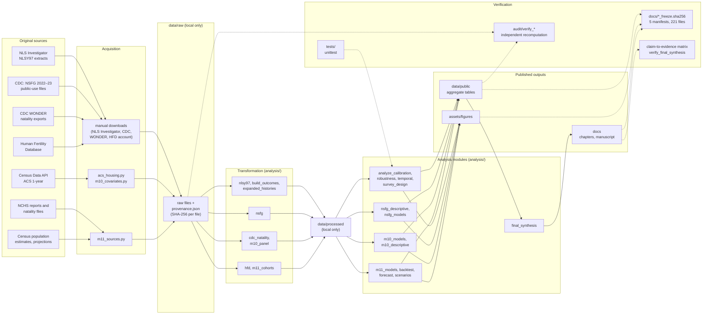

# Research pipeline and architecture

This is how I organized the project from its research question through the frozen release, and how its components fit together. For the decisions behind each step, see [`engineering_decisions.md`](engineering_decisions.md); for the results, see the [manuscript](final_synthesis_manuscript.md).

## 1. The development sequence

```mermaid
flowchart TD
    Q["1 Question and scope<br/>Will Gen Z have the families they say they want?"] --> P["2 Hypotheses and protocols<br/>locked protocols for M10, M11 and the M06 temporal check"]
    P --> A["3 Official data acquisition<br/>NLSY97, NSFG, ACS, CDC WONDER, NCHS, HFD, Census"]
    A --> I["4 Ingestion, cleaning, harmonization<br/>provenance hashes for every raw file"]
    I --> V["5 Validation and exploration<br/>benchmarks against published statistics"]
    V --> B["6 Baselines<br/>constant, class prior, no-change"]
    B --> M["7 Statistical and ML models<br/>logistic, boosting, fixed effects, ARIMA/ETS"]
    M --> F["8 Prediction and backtesting<br/>held-out households, cluster holdout, pseudo-real-time origins"]
    F --> O["9 Out-of-sample evaluation<br/>Brier, AUC, PR-AUC, MAE"]
    O --> C["10 Calibration and uncertainty<br/>Wilson, design-based, cluster-robust, historical-error"]
    C --> R["11 Robustness and sensitivity<br/>outcome rules, bounds, alternative specifications"]
    R --> X["12 Independent verification<br/>separate code recomputes headline results"]
    X --> T["13 Automated tests<br/>unittest, synthetic data, freeze checks"]
    T --> S["14 Synthesis and limitations<br/>claim-to-evidence matrix, limitations register"]
    S --> Z["15 Freeze and reproducibility<br/>SHA-256 manifests, 221 frozen files"]
```



Text version of the sequence:
1. question and scope;
2. hypotheses and protocols;
3. data acquisition;
4. ingestion and harmonization;
5. validation;
6. baselines;
7. models;
8. prediction and backtesting;
9. out-of-sample evaluation;
10. calibration and uncertainty;
11. robustness;
12. independent verification;
13. automated tests;
14. synthesis;
15. freeze.

Each chapter went through these stages and was closed before the next began; all four were later frozen by SHA-256 manifests, and the synthesis came last.

The order matters more than the box count: **I required baselines before models, fixed evaluation designs and protocols before results were seen where the design allowed it, and required independent verification before I closed each chapter and froze its files by hash.**

## 2. Which steps apply to which chapter

Not every dataset went through the same process. The four chapters answer different questions with different designs.

| Step | M01–M08 NLSY97 expectations | M09 NSFG intentions | M10 housing and fertility | M11 forecasts to 2040 |
|---|---|---|---|---|
| Design | Longitudinal: stated chance against later births | Cross-sectional survey, weighted | State-year panel, ecological | Time series and cohort projection |
| Protocol | Evaluation design documented (methodology §4). The 2015–16 temporal check was pre-specified before its outcomes were examined (§12). Later analyses are labelled exploratory | No time-stamped protocol: comparisons "planned, not pre-registered" | Protocol hashed and locked before any regression; code refuses to run if it changes | Protocol hashed and locked before any model was fitted |
| Baselines | Constant rate; stated probability unchanged | Class-prior dummy | State and year means (fixed effects) | No-change forecast |
| Models | Logistic recalibration; logistic with covariates | Penalized logistic, histogram gradient boosting | Two-way fixed-effects regression | Nine methods incl. ARIMA, ETS, drift, convergence; Lexis cohort transform |
| Prediction or backtest | Household-grouped holdout; frozen 2009 models applied to 2015–16 answers | Isolated cluster holdout | — (inference, not prediction) | 72 pseudo-real-time origins, 1952–2023 |
| Evaluation | Brier, ROC AUC, calibration slope | ROC AUC, PR-AUC, Brier, calibration | Coefficients, clustered CIs, wild bootstrap | MAE ratios, Diebold–Mariano (descriptive) |
| Uncertainty | Wilson; household-cluster bootstrap; JKn jackknife for weighted baselines | Design-based (Korn–Graubard, linearization) | Cluster-robust CR1, wild cluster bootstrap | Historical-error intervals (failed calibration) |
| Robustness | 10 outcome rules, missing-outcome bounds, pregnancy, weighting | Cohort definitions, separate-file designs, subgroup stability | Lags, periods, weighting, measures, trends, controls, leave-one-state-out | Training windows, origins, shapes, cohort conventions |
| Independent verification | `audit/verify_outcomes.py`, `verify_models.py`, `verify_temporal.py` | `audit/nsfg_stage3_checks.py`, `verify_nsfg_m09.py` (separate `svy` and Polars code) | `audit/verify_m10.py` (alternating projections, separate CR1) | `audit/verify_m11.py`, `verify_m11_forecast.py` |

**Prediction and backtesting, stated precisely.**
- **M01–M08:** the out-of-period check is a genuine forward test. Models frozen in 2009 were applied unchanged to 2015–16 answers, and the protocol was fixed before the 2021 and 2023 birth histories were examined.
- **M11:** the backtests are **pseudo-real-time**. Each origin uses only data up to that year, but from the 2026 HFD vintage, which includes later revisions. They are not forecasts that anyone could have made at the time.

## 3. Architecture



Text version:
- **Sources to raw data.** Seven official sources reach `data/raw/` (kept local) by three routes: manual downloads (NLSY97 extracts built in NLS Investigator, NSFG public-use files, CDC WONDER exports, the HFD archive, which needs an account), the Census Data API (ACS), and scripted downloads of NCHS and Census files. Every raw file is hashed in a `provenance.json`.
- **Transformation.** Chapter-specific modules in `analysis/` write respondent-level or intermediate files to `data/processed/` (local).
- **Analysis and outputs.** Analysis modules write aggregate tables to `data/public/` and figures to `assets/figures/`. `final_synthesis.py` combines the frozen outputs into the evidence table and the manuscript's figures.
- **Verification.** `audit/` verifiers recompute results from the raw data with separate code. `tests/` exercises the code on synthetic data and checks frozen outputs. Five SHA-256 manifests freeze 221 files. The claim-to-evidence matrix ties every material claim in the manuscript to a frozen value.

**What is public and what is not.** Everything to the right of `data/processed` is published. `data/raw/` and `data/processed/` stay local because they hold restricted, licensed or respondent-level data ([`security_and_disclosure_audit.md`](security_and_disclosure_audit.md)).

## 4. Repository layout

```
analysis/      research pipeline: one module per step (run as python -m analysis.<module>)
audit/         independent verifiers, freeze checker, scientific audit log
tests/         unittest suite (synthetic-data tests run anywhere; data tests skip without data)
tools/         publication tooling: release checks, README header, Pyright policy
docs/          chapters, protocols, manuscript, claim matrix, freeze manifests, publication docs
data/public/   aggregate results (the only data published)
assets/        figures and README images
.github/       CI workflows (prepared; not yet run on GitHub)
```

## 5. Running the pipeline

The order of commands for each chapter is in [`final_reproducibility_guide.md`](final_reproducibility_guide.md) section 3. The source-only checks, which need no restricted data, are in the README's Reproducibility section.
