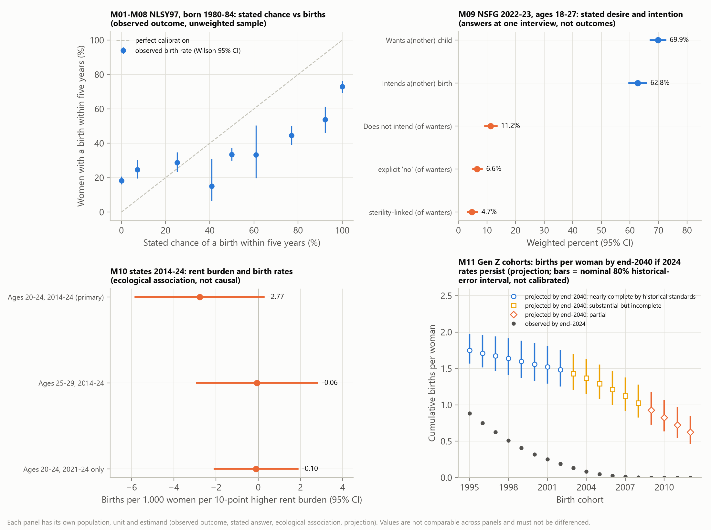
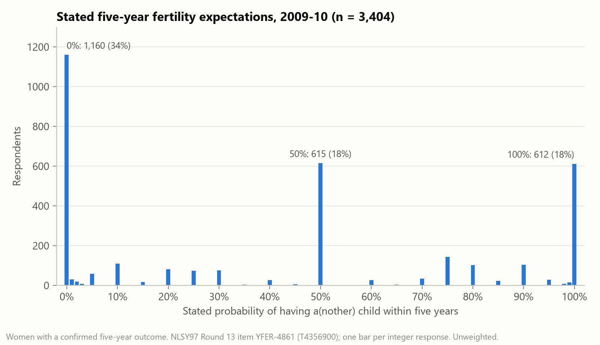
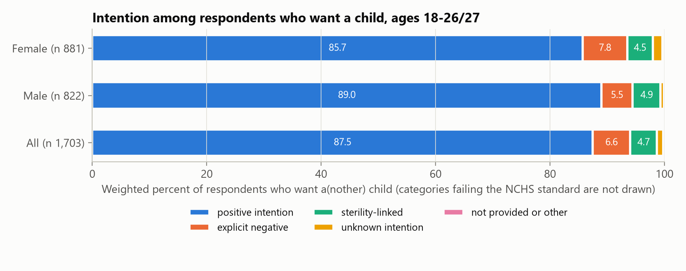
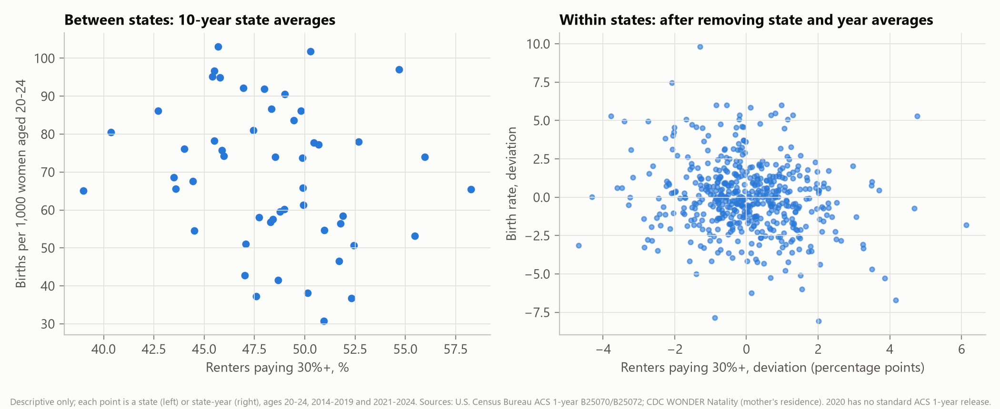
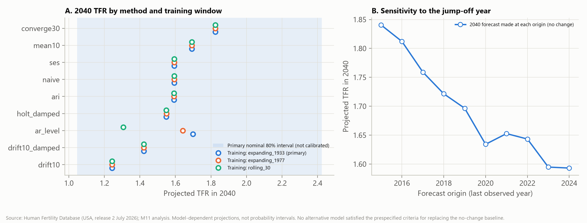
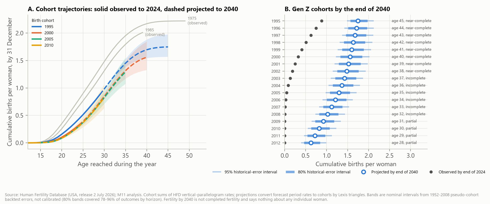

# Visual research atlas

Every validated figure in the project, grouped by research chapter. The images are the frozen research figures in [`assets/figures/`](../assets/figures/); none was redrawn or edited for publication. Each entry gives what the figure shows, who and what it measures, how to read it, and what it cannot tell you.

**Reading rules that apply everywhere**
- Each chapter studies **different people, units and measures**. Numbers from different chapters must not be added, subtracted or compared as if they measured the same thing.
- **Intervals are labelled by type.** Survey confidence intervals (M09) are design-based. Cluster-robust intervals (M10) are model-based. M11's "historical-error intervals" are built from past forecast errors, **failed their calibration check, and are not probability statements**.
- **Projections are not completed fertility.** M11 cohort values are cumulative births *by the end of 2040 if 2024 rates persist*.
- The figures use a light background in both GitHub themes. Every figure's content is also given in text here, by position and label as well as colour.

**Contents**
- [Integrated evidence](#integrated-evidence)
- [Chapter 1: Historical fertility expectations (NLSY97, M01–M08)](#chapter-1-historical-fertility-expectations-nlsy97-m01m08)
- [Chapter 2: Generation Z fertility intentions (NSFG 2022–2023, M09)](#chapter-2-generation-z-fertility-intentions-nsfg-20222023-m09)
- [Chapter 3: Housing affordability and fertility (ACS and CDC WONDER, M10)](#chapter-3-housing-affordability-and-fertility-acs-and-cdc-wonder-m10)
- [Chapter 4: Fertility forecasts and cohort trajectories to 2040 (HFD, M11)](#chapter-4-fertility-forecasts-and-cohort-trajectories-to-2040-hfd-m11)
- [Sources and attribution](#sources-and-attribution)

---

## Integrated evidence

### Who each chapter observes

- **Shows:** which birth cohorts each chapter observes, in which calendar years. Diagonals mark ages 20, 30 and 45.
- **Why it matters:** this is the project's central design constraint. No data source follows Generation Z from stated desire to completed fertility, so no desired-versus-achieved gap can be computed.
- **Units:** calendar year (x) by birth cohort (y). Shaded areas are observed data; hatching is projection.
- **Limitation:** a schematic of coverage, not of sample sizes or data quality.
- **Source:** `analysis/final_synthesis.py`; table `data/public/final/final_population_map.csv`.

### Headline estimate from each chapter

- **Shows:** one panel per chapter, each labelled with its estimand: an observed outcome, a stated answer, an ecological association, a projection.
- **Why it matters:** a single view of what each strand of evidence supports, without mixing them.
- **Uncertainty:** Wilson 95% (top left); design-based 95% (top right); state-clustered 95% (bottom left); nominal 80% historical-error intervals, not calibrated (bottom right).
- **Limitation:** the panels are not comparable with one another and must not be differenced.
- **Source:** `analysis/final_synthesis.py`; `data/public/final/final_evidence_table.csv` (22 headline estimates with locators).

---

## Chapter 1: Historical fertility expectations (NLSY97, M01–M08)

Population for every figure in this chapter: women in the NLSY97 cohort born 1980–84 who answered the 2009–10 question. All figures are unweighted sample results, not population estimates, and they describe that cohort, not Generation Z. Chapter: [`docs/methodology.md`](methodology.md).

### Stated chances clustered on 0%, 50% and 100%

- **Shows:** the distribution of answers to "what is the percent chance that you will have (a/another) child in the next five years?" (NLSY97 item YFER-4861, 2009–10).
- **Why it matters:** 70% of answers fall on three round values, so these answers behave partly like categories, not finely graded probabilities.
- **Units:** respondents per integer answer; n = 3,404 women with a confirmed five-year outcome.
- **Limitation:** unweighted; excludes the 256 women whose outcome is unknown.

### Stated chances against births that followed

- **Shows:** the share of women in each stated-probability range who had a birth within five years.
- **Why it matters:** this is the project's clearest finding about stated expectations. The answers carried real ranking information but were **far too extreme** (linear calibration slope 0.48; 1 would be perfect).
- **Units:** mean stated probability in the range (x) against the observed share with a birth (y). Labels give the range and n. Hollow points have fewer than 50 women.
- **Uncertainty:** 95% Wilson intervals.
- **Limitation:** unweighted. About 5% of women were already pregnant when they answered (methodology section 10). The finding holds under every outcome-rule and missing-outcome bound tested.

### Baselines on held-out households

- **Shows:** forecast accuracy of four approaches, from a constant rate to logistic regression with baseline characteristics, on households not used for fitting.
- **Why it matters:** recalibrating the stated answer (C) improved the Brier score from 0.249 to 0.198 without changing the ranking. Adding covariates (D) gave a smaller further gain.
- **Units:** Brier score and ROC AUC; test set of 852 women (305 births).
- **Uncertainty:** 95% household-cluster bootstrap intervals (2,000 replicates). Comparisons between approaches use paired differences (methodology).
- **Limitation:** a single split; repeated grouped cross-validation (exploratory) found the covariate gain consistent but modest.

*A prototype Streamlit dashboard for this chapter exists locally but is not part of this repository; developing it is a separate, later phase.*

---

## Chapter 2: Generation Z fertility intentions (NSFG 2022–2023, M09)

Population: U.S. household population aged about 18–26 (2022) or 18–27 (2023), the older part of Generation Z (born about 1995–2005). Weighted, design-based estimates. These are **answers at one interview, not fertility outcomes**. Estimates that fail the NCHS reliability standard for proportions are suppressed and not drawn. Chapter: [`docs/nsfg_m09.md`](nsfg_m09.md).
*Data Source: National Center for Health Statistics, National Survey of Family Growth, 2022-2023. Analyses and conclusions are the author's, not NCHS's.*

### Why some who want a child do not intend one

- **Shows:** among those who want a child (or another child), the shares who intend one, who say "no", and who were not asked because they or their partner were reported sterile.
- **Why it matters:** of those who wanted a child, 11.2% did not intend one, and about 42% of that difference was the survey's sterility classification, not a stated "no". "Sterility-linked" is the CDC recode's classification of who was asked, **not a stated preference**.
- **Units:** weighted percent of respondents who want a child; unweighted n shown. Bars run from left (positive intention) to right (explicit no, sterility-linked, unknown).
- **Limitation:** suppressed categories are not drawn; desire is yes/no, not a numeric family size.

### Wanting and intending by age and sex

- **Shows:** weighted shares by age group and sex.
- **Why it matters:** in these data, men were more likely than women to want and intend a child, and intention was lower in the oldest group.
- **Uncertainty:** design-based 95% intervals (Korn–Graubard).
- **Limitation:** a cross-section, so age differences mix age with cohort. Suppressed estimates are omitted.

### The explicit "no" across subgroups

- **Shows:** the explicit-no share among those who want a child, by subgroup.
- **Why it matters:** the intervals overlap widely. With the model results below, this gives no reliable demographic profile of who says "no".
- **Uncertainty:** 95% Korn–Graubard intervals; planned comparisons with Holm adjustment are in `subgroup_tests.csv`.
- **Limitation:** five subgroups fail the NCHS standard and are suppressed.

### Can demographics predict the explicit "no"?

- **Shows:** performance of logistic regression and gradient boosting against a class-prior baseline on an isolated cluster holdout.
- **Why it matters:** a **negative result, reported as such**. The evaluated models failed to show meaningful out-of-sample improvement (holdout AUC 0.51 against 0.50). This does not show that demographics are unrelated to intentions.
- **Units:** ROC, precision–recall and calibration on the holdout.
- **Limitation:** only 28 positive cases in the holdout; cross-validated AUC was about 0.62 with Brier skill of about 1%.

---

## Chapter 3: Housing affordability and fertility (ACS and CDC WONDER, M10)

Population: 50 states and the District of Columbia, 2014–2024 (no 2020 ACS 1-year release); women aged 20–24 and 25–29. **Ecological associations, not causal effects, and not a study of Generation Z as a cohort.** Chapter: [`docs/m10_housing_fertility.md`](m10_housing_fertility.md).

### Birth rates and rent burden over time

- **Shows:** national birth rates by age group, and the state median rent-burden share, with interquartile ranges across 51 jurisdictions.
- **Why it matters:** both series moved, but differently. The chapter asks whether, within states, years of higher burden had lower birth rates.
- **Uncertainty:** the bands show the spread across states, not confidence intervals.
- **Source:** ACS 1-year B25070/B25072; CDC WONDER Natality (mother's residence).

### Between-state and within-state variation

- **Shows:** raw cross-state differences, and the within-state variation left after two-way fixed effects.
- **Why it matters:** the within-state variation the models use is small, and about 47% of it is expected ACS sampling noise (an estimate that depends on stated assumptions), so precision is limited.
- **Limitation:** descriptive only.

### Within-state association: the primary model and robustness checks

- **Shows:** estimates from the protocol models (blue) and exploratory robustness checks (grey).
- **Why it matters:** the primary estimate at ages 20–24 was −2.77 (95% CI −5.81 to 0.26). It is **not robust** under the protocol's own rule, and there is no association at ages 25–29. The large state-only estimate shows why year effects matter.
- **Uncertainty:** state-clustered 95% intervals; the wild cluster bootstrap p-value is 0.086.
- **Limitation:** ecological; the burden measure is noisy; no causal interpretation.

---

## Chapter 4: Fertility forecasts and cohort trajectories to 2040 (HFD, M11)

Population: the United States, period and cohort fertility from the Human Fertility Database (1933–2024), with NCHS 2025 data and Census projections for comparison. Under a protocol locked before any model was fitted, **no alternative model satisfied the prespecified criteria for replacing the no-change baseline.** Chapter: [`docs/m11_fertility_forecasts.md`](m11_fertility_forecasts.md).
*Contains extracts of and values derived from Human Fertility Database estimates (www.humanfertility.org, USA release 2 July 2026, CC BY 4.0), changed by this project.*

### Observed sources and the Census assumption

- **Shows:** the HFD period TFR series, NCHS published TFRs, the 2025 value the project derived from final NCHS rates (no official 2025 TFR existed), and the Census 2023 main-series assumption.
- **Why it matters:** independent sources agree on the history, which supports using the HFD series for forecasting.
- **Limitation:** the 2025 value uses vintage 2025 denominators and is not strictly comparable with published 2024 rates.

### TFR forecast to 2040

- **Shows:** the no-change forecast (the 2024 level, 1.593) with intervals built from historical forecast errors.
- **Why it matters:** the honest forecast is "no reliable directional signal". The bands are wide and **failed their calibration check**: in pseudo-real-time tests the 80% bands covered 96% of outcomes, while the post-1977 version covered far fewer than 80% at long horizons.
- **Uncertainty:** historical-error intervals (nominal level); not validated probability intervals.

### Backtest: no alternative met the replacement criteria

- **Shows:** nine methods compared with the no-change baseline at 72 historical forecast origins.
- **Why it matters:** the locked rule required at least a 10% error reduction. The best alternative (ARIMA, ratio 0.942) did not meet it, so the baseline was retained.
- **Limitation:** "Historical" means **pseudo-real time**: every origin uses the 2026 HFD data vintage, not the data forecasters had then. At 15 years there are only four non-overlapping windows.

### Interval calibration in pseudo-real time

- **Shows:** the share of later outcomes inside each interval, using only errors observable at each origin.
- **Why it matters:** no interval method was calibrated across eras, so M11 intervals are labelled historical-error ranges, not probabilities.
- **Limitation:** long-horizon points rest on few independent windows.

### How much the 2040 forecast depends on the model and the jump-off year

- **Shows:** model dependence of the 2040 value, and its sensitivity to the last observed year.
- **Why it matters:** reasonable methods disagree by more than 0.5 births per woman, and a no-change forecast made in 2015 would have said 1.84.
- **Limitation:** these are model-dependent projections, not probability intervals.

### Age profiles and mean age at birth

- **Shows:** the shift of childbearing to older ages, and the age profile used in the projections.
- **Why it matters:** the selected fixed 2024 shape is a modelling choice. Trend-based shapes imply later childbearing.
- **Limitation:** the alternative shapes are sensitivity projections, not probability intervals.

### What is observed for Generation Z cohorts, and what must be projected

- **Shows:** for each Generation Z cohort, which ages are observed, projected, or beyond 2040.
- **Why it matters:** even the oldest Generation Z cohort is only partly observed. Reaching an age by 2040 is not the same as completing childbearing.

### Generation Z cohort fertility by the end of 2040

- **Shows:** cumulative cohort fertility if 2024 age-specific rates persist to 2040.
- **Why it matters:** the oldest Generation Z cohorts would reach about 1.5–1.75 births per woman by 2040. That is below the 1975 and 1985 cohorts at the same ages, and **nearly complete by historical standards but not completed lifetime fertility**. Cohorts born from 2003 on are far from complete.
- **Uncertainty:** nominal historical-error intervals; pseudo-real-time 80% coverage was 0.78, 0.83, 0.94 and 0.96 at 5, 10, 15 and 16 years.
- **Limitation:** conditional on persisting rates. It says nothing about any individual and is not compared with desired family size.

### Births under Census immigration scenarios

- **Shows:** births implied by no-change fertility applied to Census 2023 projected female populations, rebased to vintage 2025.
- **Why it matters:** about 3.63 million births in 2040 in the main series. Immigration scenarios shift births modestly; fertility uncertainty dominates.
- **Limitation:** scenario lines are not probabilities, and the band reflects fertility uncertainty only.

---

## Sources and attribution

- **NLSY97:** Bureau of Labor Statistics, U.S. Department of Labor, public-use data. The project is not affiliated with or endorsed by the BLS.
- **NSFG:** Data Source: National Center for Health Statistics, National Survey of Family Growth, 2022-2023.
- **CDC WONDER:** Natality data from CDC, National Center for Health Statistics. **ACS:** U.S. Census Bureau; this product uses the Census Bureau Data API but is not endorsed or certified by the Census Bureau.
- **HFD:** Human Fertility Database, Max Planck Institute for Demographic Research and Vienna Institute of Demography (CC BY 4.0).

Full notices: [`docs/licensing_and_attribution.md`](licensing_and_attribution.md).
