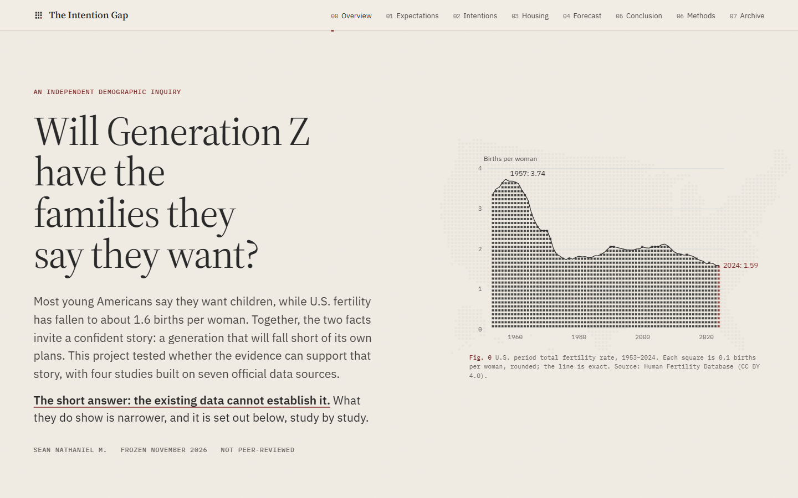

# The Intention Gap: research website

A static, single-page website that presents the frozen results of The Intention Gap for a general audience: four studies, 15 interactive charts, three scroll-driven transitions and an archive of all 21 project figures. It is part of this repository and reads the research outputs directly; it does not recompute or reinterpret any result.



**Status:** in review; not yet deployed. Hosting is not enabled.

## Requirements

- Node.js 22.23.4 or later (CI uses Node.js 26) and npm 9.6.5 or later
- This repository checked out in full: the build reads files from the folder above `website/`

## Install and develop

```
cd website
npm ci             # exact versions from package-lock.json
npm run dev        # prepares the data, then serves http://localhost:4321 with live reload
```

## Production build

```
npm run build      # writes the static site to website/dist/
npm run preview    # serves dist/ locally for a final check
```

`npm run build` runs four steps and stops at the first failure:

1. `scripts/prepare-data.mjs` reads only `data/public/`, `assets/figures/` and `docs/visual_atlas.md`. It hashes every file it reads and stops if a file listed in a `docs/*_freeze.sha256` manifest has changed. It writes `src/data/*.json` (site data, map geometry, and a provenance list with the source commit, shown in the site's Archive) and copies the figures to `public/figures/`. These generated files are not committed.
2. `scripts/check-data.mjs` confirms that the published headline values (for example 69.9%, 62.8%, 11.2%, 18.4%, 73.0%, −2.77, 1.593, 1.75, 0.62) still match the data, and that no suppressed NSFG estimate carries a value.
3. `astro build` renders the page.
4. `scripts/check-text.mjs` fails on em dashes, emoji or marketing phrases in the built page and scripts.

`INTENTION_GAP_REPO=/path/to/repository` builds from a checkout in another location.

## Technology

- [Astro](https://astro.build) 7, static output; no server code and no client framework
- [D3](https://d3js.org) 7 for the charts and map; [GSAP](https://gsap.com) 3 ScrollTrigger for the scroll-driven transitions
- A canvas particle system for the data-to-crowd, terminal-to-map and map-to-timeline transitions, and an optional runtime Atkinson dithering renderer
- [topojson-client](https://github.com/topojson/topojson-client), [topojson-simplify](https://github.com/topojson/topojson-simplify) and [us-atlas](https://github.com/topojson/us-atlas) for the dot-matrix map
- Self-hosted fonts through Fontsource: Source Serif 4, IBM Plex Sans and IBM Plex Mono

With reduced motion requested, the transitions switch between fixed states. The page is built to show the original figures and data tables when JavaScript is off.

## Assets

| Asset | Source | Terms |
|---|---|---|
| `public/photos/brossard-washington-square-{640,1024}.jpg` | David Brossard, [July Evening in Washington Square](https://www.flickr.com/photos/string_bass_dave/51729207037/), New York City, 2021 | [CC BY-SA 2.0](https://creativecommons.org/licenses/by-sa/2.0/), resized and recompressed without cropping |
| `public/photos/highsmith-shepherd-row-houses-{640,1024}.jpg` | Carol M. Highsmith, [Shepherd Street NW row houses](https://www.loc.gov/item/2010641825/), Washington, D.C., 2010. George F. Landegger Collection, Library of Congress, Prints and Photographs Division | No known restrictions on publication |
| `public/photos/highsmith-asu-palm-walk-2018.jpg` | Carol M. Highsmith, Palm Walk, Arizona State University, 2018. Library of Congress, Prints and Photographs Division, Carol M. Highsmith Archive, item [2018702287](https://www.loc.gov/item/2018702287/) | No known restrictions on publication |
| `public/photos/highsmith-huntington-homes-2015.jpg` | Carol M. Highsmith, homes in Huntington, West Virginia, 2015. Same archive, item [2015631814](https://www.loc.gov/item/2015631814/) | No known restrictions on publication |
| `public/favicon.svg` | Original | MIT, as project code |
| Figures in the Archive section | Copied at build time from `assets/figures/` | As in the [licensing register](../docs/licensing_and_attribution.md) |
| Map geometry | us-atlas, from U.S. Census Bureau cartographic boundary files | ISC; boundary data public domain |

The chapter photographs use responsive, full-color JPEGs. The original photographs and optional dithering renderer remain available. The crowd in the opening transition is generated procedurally and is illustrative; it does not depict survey participants.

## Licensing and attribution

- Website code is under the project's [MIT License](../LICENSE); its text and presentation are under [CC BY 4.0](../LICENSE-docs.md).
- The page carries the data attributions required by the [licensing register](../docs/licensing_and_attribution.md): the Human Fertility Database (CC BY 4.0, changed by this project), the NSFG data-source statement, the NCHS responsibility statement and the Census Data API notice.
- Dependencies are installed from npm and never committed. Bundled into the built site: D3, topojson and us-atlas (ISC), Astro (MIT), GSAP ([Standard "no charge" license](https://gsap.com/standard-license)) and the fonts ([SIL Open Font License 1.1](https://openfontlicense.org)).

## Deployment

Not deployed yet. `website/dist/` is a self-contained static folder: it loads no external scripts, styles or fonts, so any static host can serve it.

- **At a domain root:** serve `dist/` as built.
- **Under a sub-path** (for example a GitHub Pages project site at `/the-intention-gap/`): build with `npx astro build --base /the-intention-gap/`, or set `base` in `astro.config.mjs`. Every asset URL follows the base.

Before deploying, remove the `noindex, nofollow` robots tag in `src/layouts/Base.astro`. The page's links to this repository work once the repository is public.

CI: [`.github/workflows/website.yml`](../.github/workflows/website.yml) runs `npm ci` and `npm run build` on every change to the website or to the research files it reads. It never deploys.
